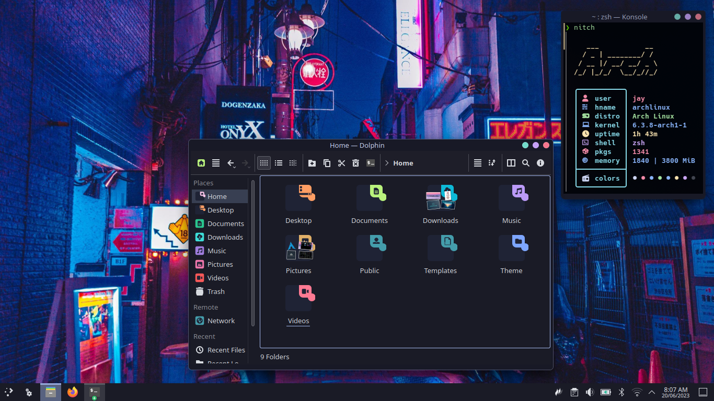

# Plasma-Tokyo-Night
Global Theme for Plasma Desktop based on the Tokyo Night color scheme.

In this Plasma 6 branch you'll find:
- Aurorae Themes
- Plasma Color Schemes
- Plasma Desktop
- Plasma Look-and-Feel Settings

# Changelogs:
[1.0.7]
Fixed bug where the window snap preview is in the wrong color [#5](https://github.com/Jayy-Dev/Plasma-Tokyo-Night/issues/5)
Fix ColorScheme ID [#4](https://github.com/Jayy-Dev/Plasma-Tokyo-Night/commit/b75dcd6664cf67ab909f625dbb27e1129c5d9ea8)

[1.0.6-Hotfix]
- Changed package naming for Plasma 5
- Changed Plasma Theme version 1.0.6-Hotfix

[1.0.6]
- Changed version from 1.0.1 to 1.0.6
- Adjusted Titlebar height and button size
- Fixed the issue where the theme is not installing properly
- Ported from Plasma 5 - 6

# Notes:
- Wallpaper is not set by default upon installation
